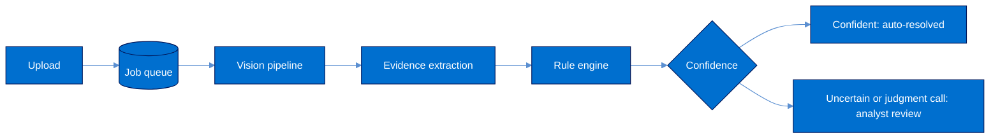

<h1 align="center">⌜ Clawback Lens ⌟</h1>

<p align="center">Reads the evidence in card disputes from scans and photos, and decides them by the rules.</p>

<br>

<p align="center">
  <a href="docs/images/dashboard.png"></a>
  <a href="docs/images/case.png"></a>
  <a href="docs/images/evidence.png"></a>
</p>

---

When a card member disputes a charge, the merchant has a fixed window to prove the sale was valid:
a signed delivery receipt, a boarding pass, a refund confirmation, an access log. Clawback Lens takes
those documents as they arrive, usually phone photos, reads them, and settles the dispute against the
reason code's evidence requirements. Every verdict cites the exact line of the document it relied on.

## How it works



**Vision.** Each page is checked for blur and contrast, binarized with Sauvola thresholding, straightened
by projection-profile deskew, and read with PP-OCR on ONNX Runtime. A signature detector looks for
handwriting the OCR did not read as text, and QR and barcode decoders run on several views of the
page. The binarization kernel is written in C++ (pybind11), since it runs on every pixel. OCR was chosen
after measuring it against Tesseract on degraded scans: 2.4% character error versus 44.6%.

**Evidence.** Two small classifiers, trained here and exported to ONNX, identify the document type and
the sentences that count as evidence. Signatures and decoded codes corroborate them. An
OpenAI-compatible model can be connected as a further signal; any claim it makes must quote the OCR
text verbatim, or it is dropped.

**Decision.** Rules are modelled on American Express chargeback reason codes (4553, 4554, 4530 and
others). The engine is a pure function: the same evidence always yields the same verdict, along with
what is missing. Models only propose evidence. A case resolves automatically when that evidence clears
a confidence threshold. Otherwise, or when the reason code calls for judgment, it goes to an analyst.

**Workflow.** Uploads return immediately and are processed by workers that claim jobs from PostgreSQL
with `FOR UPDATE SKIP LOCKED`, so workers scale horizontally without a separate broker. Retrieval
Request and response deadlines run on a scheduled sweep, and every state change lands in an
append-only audit timeline.

**Delivery.** Every push runs CI: lint, strict type checks, migration drift, 75 tests against a real
PostgreSQL, a retrain that must reproduce the committed models byte for byte, an end-to-end evaluation
with quality gates, and Docker builds. A green `main` publishes the API image and can deploy the API to
Render and the UI to Vercel.

## Results

End-to-end on 60 synthetic scans with random rotation, shadow, noise, blur and JPEG artefacts:

| Metric | Result | CI fails if |
|---|---|---|
| Document type accuracy | 1.00 | below 0.90 |
| Evidence F1 | 0.97 | below 0.80 |
| OCR character error rate | 0.020 | above 0.05 |
| Deskew error | 0.03° | above 0.5° |
| Signature F1 | 1.00 | below 0.80 |
| QR decode rate | 1.00 | below 0.90 |
| Latency per page, CPU | ~1.5 s | |

Real dispute evidence is confidential, so the training and test documents are generated. Treat these
figures as regression baselines rather than field accuracy.

## Run it

Requires Docker, Python 3.12 and Node 22.

```bash
make db                                   # PostgreSQL in Docker
python3.12 -m venv .venv && source .venv/bin/activate
make setup                                # Python deps, C++ extension, frontend deps

cd backend && cp .env.example .env && alembic upgrade head
uvicorn app.main:app --reload             # API on :8000, docs at /docs
make web                                  # UI on :3000 (second terminal)
scripts/demo.sh                           # sample disputes and scans (third terminal)
```

Or start everything with `docker compose up --build`. `make check` runs the CI checks locally, and
`make eval` runs the evaluation.

## Layout

```text
backend/app/vision        image loading, quality, binarization, deskew, OCR, signatures, codes
backend/app/ai            evidence extraction and fusion
backend/app/rule_engine   reason-code rules and the evaluator
backend/app/workflow      job queue, worker, case lifecycle
backend/app/api           FastAPI routes
backend/training, evals   synthetic corpus, training, evaluation
native/                   C++ Sauvola kernel
frontend/                 Next.js and TypeScript UI
```

## Acknowledgements

Clawback Lens grows out of what was built for the dispute-resolution track of
American Express CodeStreet 2026.Thanks to American Express and the CodeStreet organisers for the problem
statement.

Gratitute also to the open-source projects the vision pipeline stands on: [OpenCV](https://opencv.org)
for image processing, [PaddleOCR](https://github.com/PaddlePaddle/PaddleOCR) for the PP-OCR models,
and [RapidOCR](https://github.com/RapidAI/RapidOCR) and [ONNX Runtime](https://onnxruntime.ai) for
running them.

<sub>Independent project. Not affiliated with or endorsed by American Express.</sub>
